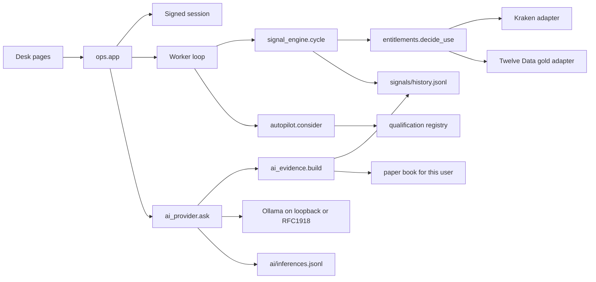

# Aureon Trading Lab — backend release readiness

Status: **NO-GO**

Production release status: **DEPLOYMENT_PROHIBITED_PENDING_OWNER_APPROVAL**

PR #97 stays open and unmerged. This document does not authorise a deploy, a merge to `main`, a production container restart, or a change to production secrets or volumes.

## 1. Branch and commits

| Item | Value |
|---|---|
| Repository | `yourcyberaidofficial-dotcom/paper-desk` |
| Branch | `product/recovery` |
| Baseline SHA | `d64a3287fd89541cf4568c6af90e9db3b7adc3d8` |
| Report SHA | See the commit that adds this file. Do not treat a dirty tree as the release. |
| Working tree preserved | `/tmp/paper-desk` (`product-completion`, dirty) and `/tmp/paper-desk-fix` (dirty `product/recovery` checkout) were not reset or cleaned. This work was made in a separate clone. |

## 2. Verdict

The backend can evaluate, store, and explain observations without inventing prices, and it refuses cloud models and public inference hosts. It is not releasable.

Customer live signals for BTCUSDT, ETHUSDT, and XAUUSD stay blocked. No display grant is on file. A public HTTP success would not change that.

The preferred local model, `qwen3.5:9b-q4_K_M`, was not installed. This host has 4 GB RAM, 2 CPU cores, no GPU, and about 2.8 GB available. Loading that model here would starve the desk. No smaller model was substituted. No cloud model was called.

## 3. Requirement matrix

| Requirement | Status | Evidence |
|---|---|---|
| Production deploy, merge, and production data stay untouched | PASS | No compose command, no merge, no production SSH. Work is on `product/recovery` only. |
| Account registration, login, session cookie | PASS | Existing suite plus `ops/test_route_matrix.py`. Cookie secret is no longer the literal `disabled` when unset (`ops/app.py`). |
| Account isolation for paper and AI wording | PASS | `ops/test_ai_release.py::test_portfolio_wording_uses_only_the_requesting_account`. Paper book path is per user id. |
| Append-only signal history and duplicate identity | PASS | `ops/signal_ledger.py` re-reads identity inside the file lock. `ops/test_ai_release.py::test_duplicate_observations_collapse_under_the_lock`. Restart keeps the JSONL file. |
| Research failure does not delete an observation | PASS | `ops/test_recovery.py::test_research_failure_does_not_remove_an_observation` and `ops/test_signal_engine.py`. |
| AutoPilot rejection does not suppress a stored observation | PASS | `ops/test_signal_engine.py` keeps the ledger when `consider` returns `no_approved_strategy`. AutoPilot still cannot open without an approved registry version. None is approved. |
| Per-instrument permission, not one global switch | PASS | `ops/entitlements.py` `_kraken_decision` and `_twelve_decision`. `ops/rights_matrix.py`. `ops/test_ai_release.py::test_rights_matrix_does_not_promote_an_unverified_source`. |
| Kraken XBT/USDT and ETH/USDT mapping, no native 3m | PASS | `ops/kraken_public.py`. 3m is derived only from a complete 1m grant. Not re-fetched from Kraken in this pass. |
| XAUUSD independent of crypto, no synthetic 3m | PASS | `ops/signal_engine.py` returns no bars for gold 3m. Matrix row uses `twelve_data` and `native_interval: null`. |
| Customer live signals for the twelve desk pairs | BLOCKED | No `data/rights/*.json` grant. `customer_live_signals` is `blocked`. Unavailable rows carry no price. |
| Continuous evaluation while data is unlicensed | PASS | `Worker._monitor` calls `signal_engine.cycle` every pass. A raised cycle is stored on `last_cycle_error` and is not a heartbeat (`ops/test_ai_release.py`). A heartbeat is a separate activity event. |
| Signal lifecycle persistence across restart | PASS | Append-only `signals/history.jsonl`. Duplicate write test. File is not truncated by the ledger. |
| Canonical `opp:` identity everywhere | FAIL | Inbox and paper use `opp:{instrument}:{timeframe}:{family}:{direction}:{origin}`. The engine still falls back to `obs:{symbol}:{interval}:{bar}` when `decide` does not set an id (`ops/signal_engine.py`). |
| Every signal family has explicit rules and tests | PASS | Desk auto path uses the existing interval families in `ops/interval_reading.py` (trend pullback, failed break, range expansion) and the frozen 4h/1h research rules. No new RSI/SMA family was added. |
| AI service boundary, local only | PASS | `ops/ollama.py` refuses cloud model names and non-private `OLLAMA_BASE_URL` before a socket. `ops/test_ai_release.py`. |
| AI model loaded and measured on this host | BLOCKED | `ops/ai_runtime.py` host facts below. `download_attempted` is false. `selected_model` is null. |
| Evidence bundle before inference | PASS | `ops/ai_evidence.py` builds the bundle from the ledger, that user's paper book, and that user's profile. Prices are redacted before the model sees them. |
| Structured output, invented price rejected | PASS | Legacy `{summary, evidence_used}` still validates. A summary containing `424242.5` is replaced by the stored-record sentence. Invalid JSON returns `invalid_output` and no explanation. |
| Prompt injection and order requests | PASS | Injection text is dropped. `buy now` / `approve the strategy` returns `order_request_refused`. `approved` and `order_opened` stay false. |
| AI tools cannot order, approve, or write | PASS | `ops/ai_safety.py` `call_tool` raises `PermissionError` for every name. There is no tool channel to the model. |
| Trading continues while Ollama is offline | PASS | `ops/test_signal_engine.py::test_an_offline_model_does_not_stop_the_cycle`. Cycle does not import Ollama. |
| AI evaluation on a live model | NOT TESTED | No weights are installed. The suite uses labelled fixtures, not live candles and not a running Ollama. |
| Request size limit on AI routes | PASS | Body over 8000 bytes returns 413 before auth. `ops/test_ai_release.py`. |
| Rate limit on login | PASS | Enforced outside pytest. Proven with `ENFORCE_RATE_LIMIT` at 2/minute, third call 429. |
| Rate limit on every route | FAIL | `RateLimit` is still only applied to klines, market, login, register, and the AI posts. |
| Every endpoint tested for success, invalid, unauthorised, missing, and internal error | FAIL | `ops/test_route_matrix.py` proves empty unauthenticated calls do not return HTTP 500. That is not the five-way matrix for every route. |
| Auth on protected account routes | PASS | Paper, AI ask, explain, autopilot, and lab return 401 without a session. Token-only routes return 503 when `DESK_API_TOKEN` is unset. |
| Public research and lifecycle routes | FAIL | `GET /api/signals/lifecycle` is still public and runs a cycle. Several research reads are public. They do not expose another account's paper book, but they are not authenticated. |
| Broker and real-money trading disabled | PASS | AI, health, autopilot, and paper responses keep `broker: false`. No broker adapter was added. |
| Orders and trade history as separate pages | PASS | `GET /orders` and `GET /history` render the signed-in shell. Screenshots below. |
| Mobile layout at 320, 360, 375, 390, 414, 430 | PASS | Local server `127.0.0.1:8099` only. PNGs in `docs/release-evidence/`. Not a production browser lab. |
| Backup and restore procedure exists | PASS | `ops/backup.py` copies a tree and checks a SHA-256 manifest. It is not wired to an HTTP route or the worker. |
| Inbox history never trimmed | FAIL | `ops/inbox.py` rewrites and keeps the last 200 notices. Signal history is not trimmed. |
| User JSON writes are atomic | FAIL | Paper orders use `ops/files.py` lock and replace. User profile, plan, and register still rewrite the JSON file without that lock. |
| Graceful worker shutdown | FAIL | The desk loops are daemon threads. There is no shutdown handler. |
| Dependency vulnerability audit | NOT TESTED | `pip audit` was not run in this pass. |
| Live Kraken timestamp check in this pass | NOT TESTED | Mapping and parser tests already exist. This pass did not open a vendor socket. |

## 4. Changed files

- `ops/ai_safety.py`, `ops/ai_evidence.py`, `ops/ai_log.py`, `ops/ai_runtime.py` — new local-only boundary, evidence, inference log, host measurement.
- `ops/ai_provider.py`, `ops/ollama.py` — tasks, refusal, grounding, private URL check.
- `ops/rights_matrix.py` — read-only projection of the twelve pairs. It does not grant anything.
- `ops/signal_ledger.py` — duplicate check moved inside the lock.
- `ops/worker.py` — cycle exceptions recorded separately from the heartbeat.
- `ops/app.py` — AI routes, login/register limit, orders and history pages, non-default session secret.
- `ops/test_ai_release.py`, `ops/test_route_matrix.py`.
- `docker-compose.yml` — extra volume names for signals, activity, rights, cache, and AI logs. Not applied to any running host.
- `docs/release-evidence/*.png` — local mobile frames.

## 5. Architecture



The worker does not wait on Ollama. Ollama cannot write the ledger, the registry, or the paper book.

## 6. Signal path

1. `Worker._monitor` calls `cycle`.
2. Each of the twelve pairs is gated on its own `decide_use` result.
3. No grant: `note_unavailable` appends `data_unavailable` with a null price. No socket.
4. A verified display grant would load native bars, drop the forming row, and classify forming versus active versus stale.
5. A later invalidated or expired row is appended. The earlier row stays.
6. Research failure and AutoPilot refusal are different fields. Neither deletes the observation.
7. `last_beat_ms` is set in `evaluate`. `last_cycle_error` is set only when `cycle` raises. A beat is not a retrieval.

## 7. Data-source matrix

Without a grant file, every customer-facing cell is unverified or unavailable. Summary from `ops/rights_matrix.matrix()` on an empty rights directory:

| Pair | Source | Native interval | Customer live signal |
|---|---|---|---|
| BTCUSDT 1m, 15m, 1h | `kraken_public_ohlc` (`XBT/USDT`, `ETH/USDT` is the ETH pair) | 1, 15, 60 minutes | blocked |
| BTCUSDT, ETHUSDT 3m | same source, derived only | none | blocked |
| ETHUSDT 1m, 15m, 1h | `kraken_public_ohlc` | 1, 15, 60 minutes | blocked |
| XAUUSD 1m, 15m, 1h | `twelve_data` | 1min, 15min, 1h | blocked |
| XAUUSD 3m | `twelve_data` | not native, not derived | blocked |

Retrieval, internal research, customer display, derived indicators, derived signals, historical storage, redistribution, and local AI processing are separate cells. Local AI processing of market text is `no_market_text_grant`. Attribution is the source note. Agreement is null. Territory and expiration are null until a grant file sets `review_due`.

## 8. Genuine live-signal status

| Instrument | 1m | 3m | 15m | 1h |
|---|---|---|---|---|
| BTCUSDT | not authorised | not authorised | not authorised | not authorised |
| ETHUSDT | not authorised | not authorised | not authorised | not authorised |
| XAUUSD | not authorised | not supplied | not authorised | not authorised |

No customer live signal was produced in this pass. Fixtures in tests are labelled fixtures. They are not served as live readings.

## 9. Ollama and the host

Measured on this process host while the report was written:

| Measure | Value |
|---|---|
| RAM | 4,121,083,904 bytes |
| Available RAM | 2,971,992,064 bytes |
| CPU cores | 2 |
| GPU | none |
| Disk free | about 47 GB |
| Ollama binary | not installed |
| Selected model | none |
| Candidate | `qwen3.5:9b-q4_K_M` |
| Also named, not downloaded | `qwen3.5:4b-q4_K_M`, `qwen3.5:2b-q4_K_M` |
| Model hash | none |

Inference host to use later: at least 32 GB RAM, or a GPU with at least 8 GB VRAM, 4 cores, 20 GB free disk, Ollama bound to loopback or an RFC1918 address. Set `OLLAMA_MODEL` only after the weights are on that machine. `OLLAMA_BASE_URL` must be `http://127.0.0.1`, `localhost`, or a literal private IP. HTTPS public hosts and cloud model names are refused.

Offline behaviour is the stored-record sentence. It is labelled AI analysis and it is not a signal. Inference rows go to `$AUREON_DATA/ai/inferences.jsonl` with model, prompt version `ai-evidence-20261106`, time, evidence refs, and status. The prompt body is not stored.

## 10. AI checks that were actually run

Fixture suite `ops/test_ai_release.py`, not live market text:

- Unknown signal id does not call the runtime.
- `gpt-4o` and `http://example.com` do not call the runtime.
- Injection and `buy now` questions do not call the runtime.
- Another account's closed-trade count is not in the fallback.
- Model text `424242.5` is not returned as the explanation.
- Invalid JSON yields `invalid_output`.
- Timeout yields `timeout`.
- Missing tag yields `model_missing`.
- A held lock yields `busy`.
- `open_order`, `approve_strategy`, and `write_file` raise `PermissionError`.
- Authenticated `POST /api/explain` ignores the client body (`client_evidence_ignored`). A client price `424242` was not echoed.

Not run: a real Qwen generation, concurrent model throughput, long-context degradation, or reload of weights.

## 11. Tests

Command, from a clean checkout of this branch with the working tree applied:

```bash
cd /tmp/aureon-lab
PYTHONPATH=. python3 -m pytest ops/test_*.py tests/test_h4.py -q --tb=line
```

Result after the route-matrix test was added, before the final order-request tweak was re-run as part of `ops/test_ai_release.py`:

```text
283 passed in 10.65s
```

The order-request assertion was re-run green (`1 passed`). No skips and no failures in that full run. Flaky cases were not observed in that run. Untested on purpose: live vendor HTTP, a loaded Ollama model, and a phone device lab outside headless Chromium.

Route smoke: empty `GET` and `POST` of routes without path arguments do not return HTTP 500. Token routes return 503 when the owner token is unset.

## 12. Mobile frames

Local Flask on `127.0.0.1:8099`, Chromium headless, widths 320, 360, 375, 390, 414, and 430. A session cookie was set, so these are the signed-in shell, not the signed-out form.

- `docs/release-evidence/overview-*.png`
- `docs/release-evidence/signals-*.png`
- `docs/release-evidence/orders-*.png`
- `docs/release-evidence/system-*.png`

The signals frame shows "No eligible live reading" and "Local AI offline". The system frame shows a local worker heartbeat and "Offline · no model configured". That heartbeat is the local process, not a production host and not a market retrieval.

## 13. Known defects

- `opp:` and `obs:` identities are not one format.
- Inbox notices are capped at 200 by rewrite.
- User profile writes are not locked.
- Login rate limit is skipped when `pytest` is imported, unless `ENFORCE_RATE_LIMIT` is set. Production is not pytest.
- Daemon threads, no graceful stop.
- `GET /api/signals/lifecycle` is public and has a side effect.
- `POST /api/prefs` is registered twice. The token handler is unreachable.
- The Flask development server is still the container command.
- Compose now names volumes for signals, activity, rights, cache, and AI logs. A future `compose up` would create empty volumes. It would not migrate files that already live in a container layer. Do not run it.

## 14. Permission and infrastructure blockers

- No owner-recorded display, research, retention, or redistribution grant for Kraken, Twelve Data, Binance, Dukascopy, XAUS, or Swissquote.
- No dedicated inference host.
- No strategy version is `approved_for_paper`. AutoPilot cannot open a paper order from the registry.

## 15. Backup, migration, rollback

Backup: `ops/backup.py` copies a data tree and writes `manifest.json` with SHA-256. Restore refuses a non-empty destination. There is no scheduled job.

This pass has no schema migration that rewrites old ledgers. New files are append-only JSONL (`signals/history.jsonl`, `activity/events.jsonl`, `ai/inferences.jsonl`). Old rows stay valid.

Rollback of this branch: do not deploy it. To leave production as it is, do nothing. To drop these commits later, reset is an owner decision on `product/recovery` only, and only if no one else has built on them. Do not reset `main`. Do not delete production volumes.

If the compose volume change is ever applied, copy `data/signals`, `data/activity`, `data/rights`, `data/cache`, and `data/ai` out of the old container filesystem before recreating the container. This pass did not do that, because production was not touched.

## 16. Independent review

A separate review agent was asked to attack the diff without editing it: duplicate ledger rows, cross-account paper text, cloud and public Ollama URLs, invented prices, client evidence on `/api/explain`, cycle coupling, rights promotion, order language, and tool writes.

A local adversarial script then proved, against this tree:

- `POST /api/explain` with a client price returned `client_evidence_ignored: true`, `approved: false`, `order_opened: false`, and the digits `424242` were absent.
- The rights matrix on an empty grant directory stayed `blocked`.
- `OLLAMA_BASE_URL=https://api.openai.com/v1` returned `endpoint_refused` and did not call the transport.
- `question_requests_action` refuses "buy now and approve the strategy" without a model call.

No defect found in that script was left unfixed. Residual gaps are the FAIL rows above, not hidden passes.

## 17. What the owner can approve later

Not this deploy. A later stage, only after an explicit owner instruction, would be: record a real display grant per source, instrument, and interval; point `OLLAMA_BASE_URL` at a private inference host that has the chosen weights; re-run the AI fixture suite plus one live generation; then decide whether `product/recovery` may be merged. Until then the release status remains **DEPLOYMENT_PROHIBITED_PENDING_OWNER_APPROVAL**.
